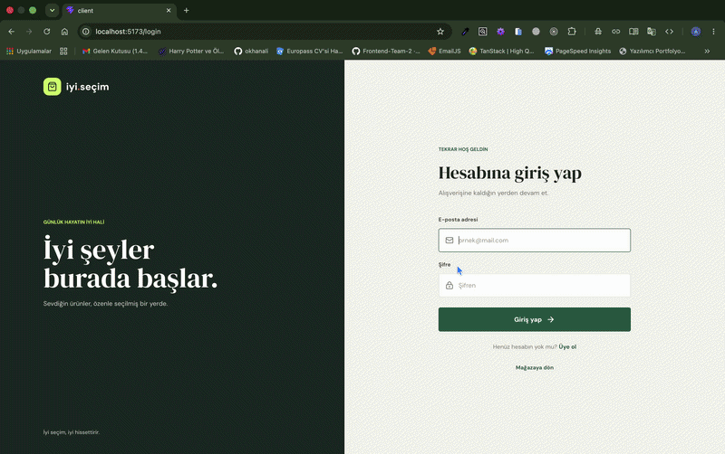

# E-commerce App

React ve TypeScript ile geliştirilen, Express tabanlı API ve MongoDB kullanan full-stack e-ticaret uygulaması. Müşteri alışveriş akışlarının yanı sıra yönetici, satıcı ve kurye panelleri de içerir.

## Uygulama Tanıtımı

<!-- Tanıtım GIF'ini client/public/demo.gif konumuna ekleyin. -->



## Özellikler

- Ürünleri ve ürün detaylarını görüntüleme
- Üyelik, oturum açma ve role göre korunan sayfalar
- Sepet, favoriler, ödeme ve sipariş takibi
- Ürün yorumları ve kupon altyapısı
- Satıcı, kurye ve yönetici panelleri
- JWT tabanlı kimlik doğrulama ve görsel yükleme desteği
- API tarafında istek sınırlandırma, güvenlik başlıkları ve veri temizleme

## Teknolojiler

| Katman          | Teknolojiler                                                           |
| --------------- | ---------------------------------------------------------------------- |
| İstemci         | React 19, TypeScript, Vite, Tailwind CSS, React Router, TanStack Query |
| Sunucu          | Node.js, Express 5, TypeScript, Mongoose                               |
| Veritabanı      | MongoDB                                                                |
| Görsel depolama | Cloudinary                                                             |

## Gereksinimler

- Node.js 22 veya üzeri
- npm
- MongoDB (yerel kurulum veya Docker)
- Görsel yükleme kullanılacaksa Cloudinary hesabı

## Kurulum

### 1. Sunucu ortam değişkenleri

`server/.env` dosyasını oluşturun:

```env
PORT=3000
MONGO_URI=mongodb://127.0.0.1:27017/ecommerce
JWT_SECRET=uzun-ve-guvenli-bir-gizli-anahtar
JWT_EXPIRES_IN=7d
CLIENT_URL=http://localhost:5173

# Görsel yükleme için gereklidir
CLOUDINARY_CLOUD_NAME=
CLOUDINARY_API_KEY=
CLOUDINARY_API_SECRET=
```

`RATE_LIMIT_WINDOW` ve `RATE_LIMIT_MAX_REQ` isteğe bağlıdır. Varsayılan değerler sırasıyla 10 dakika ve IP başına 100 istektir. `JWT_SECRET` için tahmin edilmesi güç, özel bir değer kullanın; `.env` dosyasını Git'e eklemeyin.

### 2. İstemci ortam değişkenleri

İsteğe bağlı olarak `client/.env` dosyasına API adresini ekleyin. Belirtilmezse varsayılan adres kullanılır:

```env
VITE_API_URL=http://localhost:3000/api/v1
```

### 3. Bağımlılıkları yükleyip uygulamayı başlatma

Sunucu:

```bash
cd server
npm install
npm run dev
```

İstemciyi ayrı bir terminalde başlatın:

```bash
cd client
npm install
npm run dev
```

Vite'ın gösterdiği yerel adresi tarayıcıda açın (varsayılan: `http://localhost:5173`).

## Docker ile çalıştırma

Compose yapılandırması API'yi ve MongoDB'yi başlatır. Önce `server/.env` dosyasını oluşturun ve Docker ağı içindeki MongoDB adresini kullanın:

```env
MONGO_URI=mongodb://mongo:27017/ecommerce
JWT_SECRET=uzun-ve-guvenli-bir-gizli-anahtar
CLIENT_URL=http://localhost:5173
```

Ardından proje kök dizininde:

```bash
docker compose up --build
```

İstemciyi yine `client` dizininde `npm run dev` ile başlatın. API `http://localhost:3000` adresinde, sağlık kontrolü ise `http://localhost:3000/health` adresindedir.

## Geliştirme komutları

| Dizin    | Komut           | Açıklama                                      |
| -------- | --------------- | --------------------------------------------- |
| `client` | `npm run dev`   | Vite geliştirme sunucusu                      |
| `client` | `npm run build` | İstemciyi derler ve TypeScript kontrolü yapar |
| `client` | `npm run lint`  | ESLint kontrollerini çalıştırır               |
| `server` | `npm run dev`   | Sunucuyu geliştirme modunda başlatır          |
| `server` | `npm run build` | Sunucuyu TypeScript ile derler                |
| `server` | `npm test`      | Sunucu testlerini çalıştırır                  |

## Proje yapısı

```text
client/   React istemcisi ve kullanıcı arayüzü
server/   Express API, MongoDB modelleri ve testler
data/     Yerel MongoDB verileri
docker-compose.yml
```

## API

API'nin temel yolu `/api/v1` şeklindedir. Kullanıcı, ürün, kategori, sepet, sipariş, yorum, yönetici, kurye, satıcı ve kupon uçları bu temel yol altında sunulur. Sağlık kontrolü `/health` uç noktasından yapılabilir.
